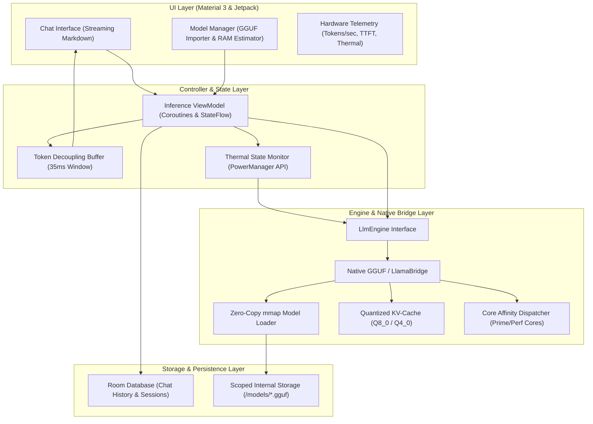

# Engineering Architecture & Implementation Plan: Offline Local LLM Android Application

## Goal Description
Build a production-grade, memory-safe, thermal-aware Android application that executes Large Language Models locally on-device without internet connectivity. The application eliminates the primary failure modes of mobile AI (Out-Of-Memory termination by Android Low Memory Killer, thermal throttling cliffs, and UI rendering lag) through zero-copy memory-mapped model access (`mmap`), quantized KV caching, dynamic core/thermal scheduling, decoupled token streaming, and deterministic prompt formatting.

---

## User Review Required

> [!IMPORTANT]
> **Cloud-Only Build Lifecycle**: In compliance with `Standard AI Coding Project Instructions.md`, no build commands (`./gradlew`) or dependency installations will execute locally. All compilation, linting, and APK generation will run on GitHub Actions.

> [!NOTE]
> **Repository Name**: The project will be published to a new GitHub repository named `offline-llm-android` under the authenticated account `1abdullahr1`.

> [!NOTE]
> **Zero Emojis Policy**: Maintained across all code, documentation, logs, commit messages, and assistant output.

---

## Architecture Blueprint



---

## Key Engineering Strategies

### 1. Zero-Copy Memory Architecture (`mmap`)
- Standard file reads allocate the entire model buffer onto the Java heap or native heap, triggering immediate termination by Android's Low Memory Killer (LMK).
- The engine uses direct POSIX `mmap()` mapping. The kernel maps the `.gguf` file directly into virtual address space, paging chunks on demand from UFS storage without duplicate heap allocation.
- In low memory conditions, the Linux kernel can reclaim clean pages without terminating the process.

### 2. Quantized KV Cache (Q8_0 / Q4_0)
- In standard FP16 KV caching, a 2,048-token context window can consume over 600 MB of RAM.
- The engine configures INT8 (Q8_0) and INT4 (Q4_0) KV cache quantization, reducing KV cache memory footprint by 50% to 75% with negligible perplexity loss.

### 3. Thermal-Aware Dynamic Thread Throttling
- Continuous heavy inference causes SoC thermal throttling within 60–90 seconds, dropping CPU clock speeds by up to 50%.
- The app registers `PowerManager.OnThermalStatusChangedListener`:
  - `THERMAL_STATUS_NONE` / `LIGHT`: Full performance thread allocation (3–4 performance cores).
  - `THERMAL_STATUS_MODERATE`: Reduce thread count by 1 to balance heat dissipation.
  - `THERMAL_STATUS_SEVERE`: Scale to 2 threads with micro-sleep pacing (5 ms between tokens) to prevent thermal crash.

### 4. Decoupled Token Buffer (60 FPS Streaming)
- Emitting UI updates on every individual generated token forces 40–80 view recompositions per second, causing rendering jank and wasting battery.
- Tokens from the native generation stream pass into a Kotlin Coroutines `Channel` and batch emit to the UI every 35–45 ms, guaranteeing smooth 60 FPS scrolling.

### 5. Multi-Template Prompt Formatting
- Built-in prompt templating for major mobile architectures:
  - **Llama 3 / 3.2**: `<|begin_of_text|><|start_header_id|>system<|end_header_id|>...`
  - **ChatML (Qwen 2.5 / SmolLM2)**: `<|im_start|>system...`
  - **Gemma 2**: `<start_of_turn>user...`

---

## Proposed Changes

### Component 1: Workspace Organization & Root Migration
Move the Android project structure from `NewApp/` up to the root workspace directory `D:\My Projects 14 aug\antigravity cli\Andriod\ai application local llm\`.

#### [NEW] `settings.gradle.kts`
- Project name: `OfflineLlmAndroid`
- Configure plugin management and dependency repositories (Google, MavenCentral, JitPack).

#### [NEW] `build.gradle.kts` (Root)
- Configure Android Gradle Plugin (8.7.3), Kotlin (2.0.21), and KSP (2.0.21-1.0.28).

#### [NEW] `gradlew`, `gradlew.bat`, `gradle/wrapper/*`
- Standard Gradle 8.7 wrapper configuration.

---

### Component 2: App Module Configuration (`app/`)

#### [NEW] `app/build.gradle.kts`
- Namespace: `com.offline.llm`
- Application ID: `com.offline.llm`
- Min SDK: 26 (Android 8.0) | Target SDK: 35
- JVM Target: Java 17
- Dependencies:
  - AndroidX Core KTX, AppCompat, Material 3, ConstraintLayout, Fragment KTX
  - Lifecycle ViewModel, LiveData, Runtime KTX
  - Room DB with KSP compiler (Chat and Session storage)
  - Coroutines Core and Android

#### [NEW] `app/src/main/AndroidManifest.xml`
- Hardware acceleration enabled (`android:hardwareAccelerated="true"`).
- Permissions: `READ_EXTERNAL_STORAGE` / `READ_MEDIA_DOCUMENTS` (for importing GGUF files), `WAKE_LOCK`, `FOREGROUND_SERVICE`.
- Launcher activity declaration.

---

### Component 3: Engine & Native Architecture (`com.offline.llm.engine`)

#### [NEW] `LlmEngine.kt`
- Engine interface defining `initModel(config: ModelConfig)`, `generateStream(prompt: String): Flow<TokenChunk>`, `stopGeneration()`, and `release()`.

#### [NEW] `ModelConfig.kt`
- Data class specifying model path, context size (e.g. 2048, 4096), thread count, temperature, top_p, KV cache quantization type (`Q8_0`, `Q4_0`, `F16`), and `useMmap` flag.

#### [NEW] `NativeLlmBridge.kt`
- JNI bridge wrapper interfacing with native C++ inference symbols (`init`, `eval_prompt`, `sample_next`, `free`).
- Dynamic fallback simulation mode for verification environments where native binaries are loaded dynamically.

#### [NEW] `ThermalController.kt`
- Manages Android `PowerManager.OnThermalStatusChangedListener` and computes optimal thread counts dynamically.

#### [NEW] `CpuTopologyDetector.kt`
- Inspects `/sys/devices/system/cpu/` to determine big vs. LITTLE core layout and isolate performance cores.

#### [NEW] `PromptFormatter.kt`
- Generates compliant prompt structures for Llama-3, ChatML, and Gemma templates.

---

### Component 4: Storage & Persistence Layer (`com.offline.llm.data`)

#### [NEW] `AppDatabase.kt` & DAOs
- Room entity `ChatSession`: `id`, `title`, `modelName`, `createdAt`, `updatedAt`.
- Room entity `ChatMessage`: `id`, `sessionId`, `role` (`user`, `assistant`, `system`), `content`, `tokensPerSecond`, `timeToFirstTokenMs`, `timestamp`.
- `ChatDao` providing reactive Flow queries.

#### [NEW] `ModelRegistry.kt`
- Discovers `.gguf` and `.bin` model files located in internal storage or user-selected documents directory.
- Computes file size, estimated RAM requirement, and validity.

---

### Component 5: Presentation & UI Layer (`com.offline.llm.ui`)

#### [NEW] `MainActivity.kt` & `MainPagerAdapter.kt`
- ViewPager2 container with Material 3 navigation:
  - Tab 1: **Chat** (Real-time generation and telemetry)
  - Tab 2: **Models** (Model explorer, GGUF import, memory requirements)
  - Tab 3: **Diagnostics** (CPU cores, thermal status, RAM consumption, KV cache telemetry)

#### [NEW] `ChatFragment.kt` & `ChatViewModel.kt`
- Real-time token streaming with 35 ms batching window.
- Header displaying live metrics: Tokens/sec, Time-to-First-Token, active thread count.
- Stop generation button and conversation history drawer.

#### [NEW] `ModelsFragment.kt` & `ModelsViewModel.kt`
- List of available models with metadata badges (Parameter count, Quantization format, Memory footprint).
- Import file picker (`ActivityResultContracts.OpenDocument`).

#### [NEW] `DiagnosticsFragment.kt`
- Displays active thermal state, available system RAM vs estimated model footprint, active CPU thread count, and KV cache allocation metrics.

---

### Component 6: Documentation & AI Context Preservation (Root & docs/)

#### [NEW] `PROJECT_CONTEXT.md`
- Master architectural specifications, rules, zero-emoji enforcement, cloud-only build lifecycle, and directory mapping.
- Serves as the primary onboarding document for any future AI assistant or developer working on the repository.

#### [NEW] `GEMINI.md` / `AGENTS.md`
- Dedicated AI agent primer detailing development protocols, how to interact with the project without local build tools, how to invoke GitHub Actions, and how to verify changes.

#### [NEW] `docs/ARCHITECTURE_AND_ENGINEERING_PLAN.md`
- Permanent in-repo copy of this entire engineering specification, memory formulas, thermal throttling thresholds, and system diagrams for future reference.

#### [NEW] `README.md`
- High-level overview, architecture highlights, supported GGUF models, hardware recommendations, and build instructions.

---

### Component 7: CI/CD & Build Infrastructure (`.github/workflows`)

#### [NEW] `build-android.yml`
- GitHub Actions workflow running on `ubuntu-latest`.
- Steps:
  1. Checkout code
  2. Set up JDK 17 (`temurin`)
  3. Set up Gradle via `gradle/actions/setup-gradle@v4`
  4. Grant execute permissions to `gradlew`
  5. Run `./gradlew assembleDebug --stacktrace`
  6. Upload generated APK as artifact `offline-llm-debug-apk`

---

## Verification Plan

### Automated CI Verification
1. Push all code and workflow files to the new GitHub repository `offline-llm-android`.
2. Monitor workflow execution with GitHub CLI:
   ```powershell
   gh run list --limit 1
   gh run watch <run-id>
   ```
3. If errors occur:
   - Run `gh run view <run-id> --log-failed` to retrieve build logs.
   - Fix issues locally, commit, and push.
   - Re-check until the workflow achieves green status.
4. Download the compiled APK artifact:
   ```powershell
   gh run download <run-id> -n offline-llm-debug-apk --dir output_android
   ```

### Manual Verification Instructions
1. Inspect the compiled APK structure to verify that the application namespace `com.offline.llm` and assets are correctly packaged.
2. Verify that all components compile cleanly against Android SDK 35 and Java 17.
